<!-- Hacker-style character-art avatar on neon code rain (generated by make_ascii_hero.py) -->
<p align="center">
  
</p>

<h1 align="center">Md Tanvir Ahmed</h1>
<p align="center"><b>Azure Data Engineer</b> · Databricks · PySpark · Azure Data Factory · Synapse · Microsoft Fabric · Power BI</p>
<p align="center">I design and build cloud data pipelines and medallion-architecture lakehouses on Azure (batch and streaming), and I'm currently adding AI, LLM and RAG skills. Open to Data Engineer roles.</p>

<p align="center">
  <a href="https://edutanvir.github.io"></a>&nbsp;
  <a href="https://www.linkedin.com/in/tanvir-de/"></a>&nbsp;
  <a href="https://github.com/edutanvir?tab=repositories"></a>&nbsp;
  
</p>

---

## 👨‍💻 About me

```python
class AzureDataEngineer:
    def __init__(self):
        self.name        = "Md Tanvir Ahmed"
        self.experience  = "4+ years"
        self.superpower  = "Turning messy data into reliable Gold-layer insights"
        self.currently   = ["Building end-to-end Azure projects", "Learning AI / LLM / RAG"]
        self.looking_for = "Data Engineer roles where I can build at scale"
        self.fun_fact    = "I post on LinkedIn every single day 📝"

    def say_hi(self):
        print("Let's build something great together! 🚀")
```

---

## 🛠️ Tech stack

<p align="center">
  
</p>

<div align="center">

| Category | Tools |
|:--|:--|
| ☁️ **Cloud** |      |
| 🔄 **Orchestration** |   |
| ⚡ **Processing** |      |
| 📊 **BI** |  |
| 🔐 **Security & DevOps** |      |
| 🤖 **Learning now** |    |

</div>

---

## 🚀 Featured projects

<div align="center">

| Project | What it shows | Stack |
|:--|:--|:--|
| 🛢️ **Oil & Gas Price Pipeline** | End-to-end medallion architecture | `ADF` `Databricks` `PySpark` |
| 🚕 **NYC Taxi Pipeline** | Large-scale and streaming data | `Databricks` `Spark` `ADLS Gen2` |
| 🛒 **Retail Sales Analytics** | Bronze → Silver → Gold, star schema, KPIs | `Synapse` `ADLS Gen2` `Power BI` |
| 🏥 **Healthcare Analytics** | Fabric + Power BI dashboards | `Fabric` `Power BI` |

</div>

---

## 📊 GitHub stats

<p align="center">
  
  
</p>
<p align="center">
  
</p>

## 🐍 Contribution snake

<p align="center">
  <picture>
    <source media="(prefers-color-scheme: dark)" srcset="https://raw.githubusercontent.com/edutanvir/edutanvir/output/github-snake-dark.svg" />
    <source media="(prefers-color-scheme: light)" srcset="https://raw.githubusercontent.com/edutanvir/edutanvir/output/github-snake.svg" />
    
  </picture>
</p>

---

<p align="center">
  
</p>
<p align="center"><i>Thanks for stopping by! If you're hiring for Azure data roles, I'd love to chat. ✨</i></p>
